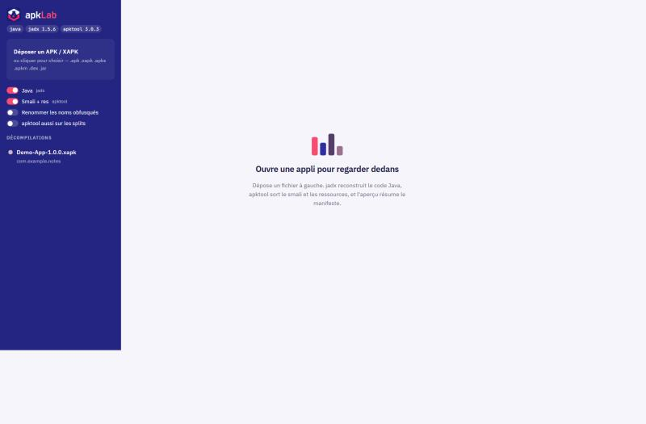
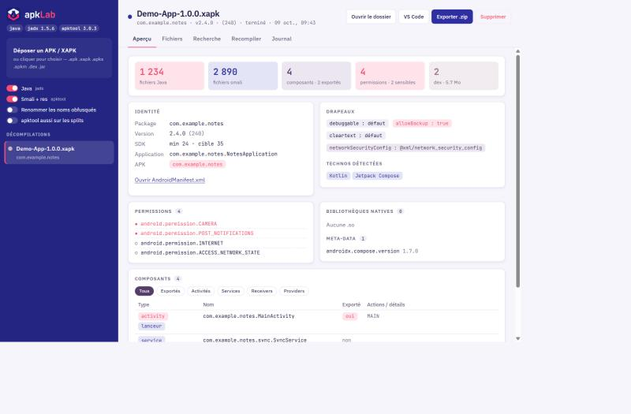
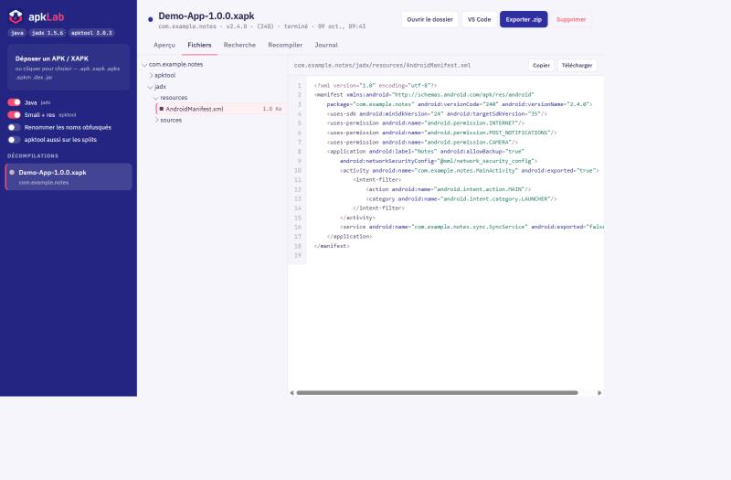
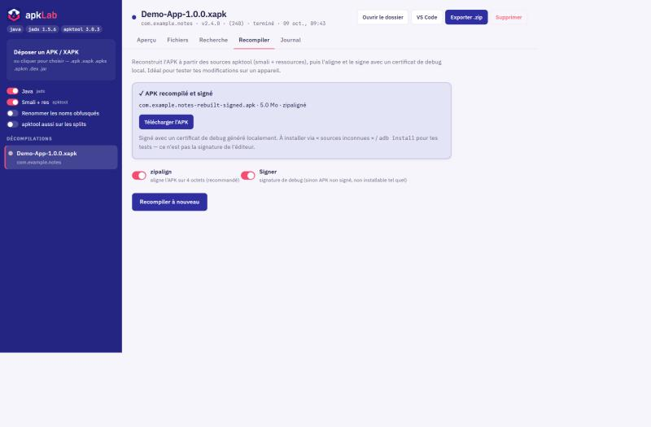

<div align="center">


# APK Lab

**Décompile, explore, recompile et signe des APK / XAPK — en local, dans ton navigateur.**


[**⬇ Télécharger l'installeur (.msi)**](../../releases/latest)

</div>

---

APK Lab enveloppe **jadx** et **apktool** dans une interface web épurée et locale. Tu déposes un APK ou un XAPK, il reconstruit le code Java, sort le smali et les ressources, résume le manifeste, puis te laisse **recompiler et signer** l'APK pour le tester sur un appareil. Rien ne quitte ta machine.

## Captures

<div align="center">

 
 

</div>

## Fonctionnalités

- 📦 **APK, XAPK, APKS, APKM** — extraction automatique de l'APK de base et des splits.
- ☕ **Code Java** reconstruit par jadx, **smali + ressources** par apktool.
- 🔎 **Aperçu** : package, versions, SDK, drapeaux (`debuggable`, `allowBackup`, cleartext…), permissions sensibles mises en avant, composants exportés, bibliothèques natives, et détection des technos (Flutter, React Native, Unity, Xamarin, Capacitor/Cordova, Kotlin, Compose, PairIP…).
- 🗂️ **Explorateur de fichiers** avec coloration syntaxique (Java, Kotlin, smali, XML…), images et aperçu hexadécimal des binaires.
- ⚡ **Recherche** plein texte / regex sur tout le code, avec des recherches prêtes à l'emploi (URLs, secrets, Firebase, WebView, certificate pinning…).
- 🔧 **Recompilation + signature** : `apktool b` → `zipalign` → `apksigner` avec un certificat de debug généré localement, en un clic.
- 💾 **Export `.zip`**, ouverture du dossier dans l'Explorateur ou VS Code.
- 🎨 Interface claire/sombre, sans dépendance externe (hors coloration syntaxique via CDN).

## Installation

### Avec l'installeur (recommandé)

1. Télécharge le **`.msi`** depuis la [page Releases](../../releases/latest).
2. Lance-le : il demande **où installer** (par défaut `C:\Program Files\APK Lab`) et propose de créer un **raccourci sur le bureau**.
3. Ouvre **APK Lab** depuis le menu Démarrer ou le bureau.

**Prérequis** sur la machine :

| Outil | Pourquoi | Où |
|---|---|---|
| **Python 3.10+** | fait tourner l'app | [python.org](https://www.python.org/downloads/windows/) (coche « Add to PATH ») |
| **JDK 17+** | exécute jadx / apktool | fourni avec Android Studio, ou [Temurin](https://adoptium.net/) |
| **Android SDK build-tools** | `apksigner` + `zipalign` (signature) | Android Studio |

Au premier lancement, APK Lab télécharge jadx et apktool dans `%LOCALAPPDATA%\APK Lab\tools`.

### Depuis les sources

```bash
git clone <url-du-repo>
cd apklab
python setup.py        # télécharge jadx + apktool
python server.py       # ouvre http://127.0.0.1:7341
```

## Utilisation

1. **Dépose** un `.apk` / `.xapk` dans la zone à gauche (ou clique pour choisir).
2. Choisis ce que tu veux produire (jadx, apktool, déobfuscation, splits).
3. Suis la progression ; à la fin, explore l'**Aperçu**, les **Fichiers**, la **Recherche**.
4. Onglet **Recompiler** : reconstruis et signe l'APK, puis télécharge-le.

L'APK recompilé est signé avec un **certificat de debug local** : installe-le via « sources inconnues » ou `adb install -r`. Ce n'est pas la signature de l'éditeur d'origine.

## Comment ça marche

```
server.py        serveur HTTP (stdlib Python) + file de décompilation + analyse du manifeste
paths.py         emplacements (dev : à côté du code ; installé : %LOCALAPPDATA%\APK Lab)
setup.py         télécharge jadx + apktool depuis leurs releases GitHub officielles
static/          interface web (HTML / CSS / JS, sans framework)
installer/       source WiX + script de construction du MSI
tools/           jadx, apktool, keystore de debug (hors dépôt)
workspace/<id>/  entrée, sortie (out/), build/ (APK recompilé), journaux
```

- **Décompilation** : `jadx -d … --show-bad-code` et `apktool d -f --keep-broken-res`.
- **Recompilation** : `apktool b` → `zipalign -p 4` → `apksigner sign` (keystore RSA 2048 généré par `keytool`).
- **Analyse** : parse `AndroidManifest.xml`, repère permissions dangereuses, composants exportés, `.so` et empreintes de frameworks.

## Sécurité & vie privée

- Le serveur n'écoute que sur **`127.0.0.1`** et rejette les en-têtes `Host` étrangers (anti DNS-rebinding).
- Toute action nécessite l'en-tête **`X-ApkLab`** (anti-CSRF depuis un autre site).
- Les chemins qui sortent du dossier du job sont bloqués, y compris les entrées piégées dans les archives.
- **Tout reste local** : aucun fichier n'est envoyé sur Internet (hors téléchargement initial de jadx/apktool depuis GitHub).

## Construire le MSI soi-même

```bash
python installer/build_msi.py 1.0.0.0
# -> installer/dist/APKLab-1.0.0.0.msi   (WiX v3 est téléchargé automatiquement)
```

## Crédits

- [jadx](https://github.com/skylot/jadx) — décompilateur Dex → Java
- [Apktool](https://github.com/iBotPeaches/Apktool) — ressources & smali
- [WiX Toolset](https://wixtoolset.org/) — construction du MSI

## Avertissement

Outil destiné à l'**expérimentation et à l'analyse de tes propres applications** ou d'applications que tu es autorisé à étudier. Respecte les licences et les droits attachés aux applications que tu décompiles. Fourni « tel quel », sans garantie.
